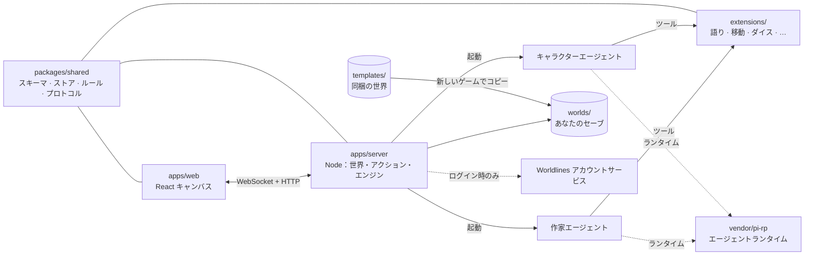

<div align="center">


# LivingCanvas

**ひとつの無限キャンバスで遊ぶ AI ロールプレイゲーム。あなたと作家エージェント、そしてキャラクターたちのエージェントが、同じ生きた世界を分かち合います。**

[English](README.md) · [简体中文](README.zh-CN.md) · **日本語** · [한국어](README.ko.md)

[オンラインで遊ぶ](https://canvas.worldlines.gg/?lang=ja&src=github) · [1 分の紹介映像](https://youtu.be/FnUXFOv74Tg) · [ガイド（英語）](guide/) · [Discord](https://discord.gg/6KYtmZQhnR)

[](LICENSE)
[](CONTENT-LICENSE.md)
[](https://nodejs.org/)
[](https://pnpm.io/)
[](https://www.typescriptlang.org/)
[](https://react.dev/)
[](templates/)

[](https://canvas.worldlines.gg/?lang=ja&src=github)
[](https://youtu.be/FnUXFOv74Tg)
[](https://discord.gg/6KYtmZQhnR)
[](CONTRIBUTING.md)
[](.github/CLA.md)
[](https://github.com/LudicDynamics/LivingCanvas/stargazers)
[](https://github.com/LudicDynamics/LivingCanvas/commits)

</div>


## LivingCanvas とは

LivingCanvas は、シナリオがあらかじめ書かれていない物語ゲームです。場所も、シーンも、台詞も、その結果も、すべてプレイ中に AI エージェントがその場で書き起こします。そして世界そのものは、Markdown ファイルを詰めたひとつのフォルダにすぎません。

- **ひとつの無限キャンバス。** 世界は地図、港、事務所、引き出し……と重なり合う「場所」でできていて、シーンはどれもキャンバス上の一枚のカードです。地の文、手紙、小道具、扉、人物。スクロールし、ズームし、ドラッグして開けてみる。足を踏み入れた先へ、世界は広がっていきます。
- **そばにいるキャラクター。** キャラクターはそれぞれ独立したエージェントです。キャンバス上であなたの隣に立ち、場所を移ればついてきて、起きたことを覚えていて、テキストや音声で二人きりの会話もできます。世界によっては自分から動くことも。キャラクターが知っているのはその人物が知り得ることだけで、事件の真相は見えていません。
- **作家エージェント。** 作家はゲームマスター役です。語り、新しい場所を開き、手がかりや品物を卓に並べ、時間を管理し、あなたの行動に何の代償がつくかを決めます。じっくり考えるのは大事な場面だけ。オプションの「高速モード」を使えば、ふだんのやり取りはモデル呼び出し一回で返ってきます。
- **TRPG のダイス。** 調べる、説得する、よじ登る——判定は 3D のダイスに委ねられ、結果は大成功・成功・失敗・大失敗の四段階。どの結果にも、世界に書き込まれる帰結があります。
- **集めたくなるエンディング。** ミステリーや TRPG の世界には制限時間があり、いくつかあるエンディングのどれかにたどり着きます。犯人を名指しする、時間切れになる、乗る列車を間違える。到達したエンディングはコレクションに残り、遊ぶたびに真相が変わる世界もあります。
- **世界は Markdown のフォルダ。** プレイヤーとエージェントは同じファイルを編集し、変更のひとつひとつがイベントになります。テキストエディタで世界を書いてもいいし、作家と一緒に育ててもかまいません。

## クイックスタート

必要なものは **Node.js 22 以上**、**pnpm 10 以上**、**git**、それに OpenAI 互換のモデルプロバイダ（OpenAI、DeepSeek、ローカルのサーバーなど）の API キーです。Worldlines アカウントはなくても遊べます。

```bash
git clone --recurse-submodules https://github.com/LudicDynamics/LivingCanvas.git
cd LivingCanvas

# 1. エージェントのランタイム（vendor/pi-rp、git サブモジュール）：最初に一度だけインストールしてビルド
(cd vendor/pi-rp && npm install)
pnpm install
pnpm pi build

# 2. LivingCanvas 本体をビルド
pnpm build

# 3. 遊ぶ
pnpm dev            # API は :3001、キャンバスは http://localhost:5173
```

<http://localhost:5173> を開き、ロビーで世界を選んで新しいゲームを始めてください。ビルドには二つのモードがあり、[`config/.env.local`](config/.env.local) の一行で切り替わります。

| | **`WORLDLINES_LOGIN=off`**：自分のキーで、アカウントなし | **`WORLDLINES_LOGIN=on`**（初期設定）：自分のキー＋任意で Worldlines アカウント |
|---|---|---|
| モデルの用意 | `cp .env.example .env.local` して `OPENAI_API_KEY`（と／または `DEEPSEEK_API_KEY`）を設定するか、ゲーム内の**設定**にキーを貼り付ける | 同じく自分のキーを `.env.local` か**設定**で指定。**アカウント**画面からログインすると、キーを持っていないサービスにはアカウントのクレジットが使えます。自分のキーが常に優先されます |
| 世界に入るには | いつでも入れます | このリポジトリの世界と自分のセーブ：ログイン不要でいつでも。ほかのプレイヤーが Worldlines で共有した世界：先にログイン |
| Worldlines との通信 | 一切なし | ログイン前は匿名の公開データの読み込み（お知らせ、料金プラン一覧）だけ。ログイン後にアカウントのサービスへ接続します |

**設定 → 接続テスト**で、どのモデル、音声、音声認識が応答するかを確認できます。モデルがひとつもなくてもゲームは起動して、あたりを見て回れます。キャラクターに話しかけると、先にモデルを設定するよう案内が出ます。

キーはあなたのマシンから出ません。物語のエージェントからも読めません。エージェントのファイルアクセスは世界のフォルダ内に限られ、キーの環境変数はエージェントに渡されないからです。サーバーは `127.0.0.1` でだけ待ち受けます。

詳しくは [設定リファレンス](guide/configuration.md)（英語）を。すべての環境変数、独自のプロバイダ、音声、作家の速度設定について書いてあります。

## 同梱の世界

このリポジトリには [`templates/`](templates/) に八つの世界が入っていて、どれも英語版のほか日本語（`-jp`）、韓国語（`-ko`）、中国語（`-zh`）版があります。ホスト版にはこのほかにもいくつか世界がありますが、それらはこのリポジトリには含まれていません。

**これらの世界は二次創作できます。** ライセンスは [CC BY-NC 4.0](CONTENT-LICENSE.md)（表示—非営利）です。非営利で、クレジットを表示すれば、共有も改変も、続編や翻訳や新しいキャラクターの追加も自由です。クレジットの書き方は [CONTENT-LICENSE.md](CONTENT-LICENSE.md) を見てください。


| 世界 | フォルダ | 種類 | ひとことで |
|---|---|---|---|
| **霧埠の町・潮の前** | `wuwu` | TRPG · ミステリー | 霧に閉ざされた港に、誰も乗っていない「幽霊船」が流れ着く。潮が戻るまで、残り八手。 |
| **ホームズ：四つ目の事件** | `whitechapel` | TRPG · ミステリー | あなたはシャーロック・ホームズ。誰かが連載小説の挿絵を、本物の事件として再現している。 |
| **終電**（5 分の**序章**つき） | `last-train`、`last-train-prologue` | TRPG · 密室 | 山あいの終電がトンネルの中で止まり、17 番席の乗客が消えた。 |
| **未書の扉** | `unwritten-door` | TRPG · オープン | 山小屋、一通の手紙、電池の切れた携帯。扉の向こうの世界は、進むほどに書かれていく。 |
| **月下の誓い** | `moonlit-contract` | 物語 · ファンタジー | 海辺の天文台で騎士を召喚すると、彼女は契約を持ちかけてくる。 |
| **魔法学院**（作：Mingyue） | `magic-academy` | 物語 · 実験 | 言葉と品物と代価を組み合わせ、魔法に名前をつけて、閉ざされた部屋を変える。 |
| **潮見島** | `islet` | 自由 · 実験 | 週に一便の渡し船、七人の島民、荒れた畑がひとつ。あなたがいなくても、島の暮らしは続いていく。 |

## 全体の構成



プレイヤーの一手——作家に話しかける、選択肢を選ぶ、鍵を錠前へドラッグする、ダイスを振る——はサーバーに届き、作家（または一回呼び出しの高速モード）に渡されます。サーバーは世界ごとのコマンドと時間を進め、変更をセーブのファイルに書き込み、結果をフレームとしてキャンバスへ送り返します。詳しくは [アーキテクチャとターンの流れ](guide/architecture.md)（英語）を。

| フォルダ | 中身 |
|---|---|
| `apps/server/` | Node.js + WebSocket サーバー：世界のルーティング、アクション処理、エンジン、エージェントの管理 |
| `apps/web/` | React 19 + Tailwind + Vite のキャンバス・フロントエンド |
| `apps/browser-runtime/` | 実験的なブラウザモード：同じサーバーとエージェントを Web Worker の中で動かす |
| `packages/shared/` | 世界のスキーマ、ファイルストア、アクション、ルール、WebSocket プロトコル |
| `extensions/` | エージェントが使うツール |
| `presets/`、`skills/` | 作家とキャラクターのプロンプトとスキル |
| `templates/` | 同梱の世界（コンテンツ、CC BY-NC 4.0） |
| `assets/` | 共通の音声素材（`assets/audio/CREDITS.md` を参照）と 3D ダイス |
| `tools/` | スキャフォールド、プローブ、契約チェック |
| `vendor/pi-rp/` | エージェントランタイム（git サブモジュール、MIT） |
| `vendor/worldlines-identity-client/` | Worldlines アカウントにログインするためのクライアント |

## 自分の世界をつくる

```bash
node tools/scaffold.mjs --template moonlit-contract --out worlds/my-world
```

世界はひとつのフォルダです。ルール（時間制限、エンディング、ダイス、キャラクター）は `world.json` に、場所ごとにディレクトリ、カードごとに Markdown ファイル、キャラクターごとにフォルダ。ファイルを書き換えればそのまま遊べますし、ゲーム内のワークショップで開いて作家と一緒に作ることもできます。`worlds/` はセーブや自作の世界を置く場所で、コミットされることはありません。詳しくは [世界の書き方](guide/world-authoring.md)（英語）を。

## オープンソースの範囲

ゲーム本体——サーバー、キャンバス、エージェントのツール、プロンプト、そして八つの世界——はこのリポジトリにあります。[canvas.worldlines.gg](https://canvas.worldlines.gg/?lang=ja&src=github) のホスト版も同じコードで動いていますが、それに加えて**オープンソースではない**アカウントサービス（ログイン、クラウドセーブと世界の共有、モデルのクレジット、音声、課金）を使っています。`WORLDLINES_LOGIN=off` にすれば、これらのサービスには何も送られません。

| 対象 | ライセンス |
|---|---|
| **コード**（`apps/`、`packages/`、`extensions/`、`tools/`、`vendor/worldlines-identity-client/`） | [Apache License 2.0](LICENSE) |
| **コンテンツ**（同梱の世界、キャラクター、アート、プロンプト、スキル。正確なパスはファイル内に記載） | [CC BY-NC 4.0](CONTENT-LICENSE.md)（表示—非営利） |
| **名称とロゴ**（「LivingCanvas」「Worldlines」、ブランド素材） | Ludic Dynamics の商標で、ライセンスの対象外。[TRADEMARKS.md](TRADEMARKS.md) を参照 |
| **サードパーティ**（pi-rp ランタイム、共通の音声素材、フォント） | それぞれのライセンス。[NOTICE](NOTICE) と [`assets/audio/CREDITS.md`](assets/audio/CREDITS.md) を参照 |

なぜこう分けているのか、フォークや自作の世界の扱い、商標の使い方、コントリビューター・ライセンス契約（CLA）については [LivingCanvas のオープンソース](guide/open-source.md)（英語）にまとめてあります。

## コントリビュート

バグ報告、世界、翻訳、プルリクエスト、どれも歓迎です。まず [CONTRIBUTING.md](CONTRIBUTING.md) を読んでください。初めてプルリクエストを送ると、CLA Assistant のボットが[コントリビューター・ライセンス契約](.github/CLA.md)へのワンクリック署名をお願いします（著作権はあなたに残ります）。セキュリティの問題は公開の issue ではなく、[SECURITY.md](SECURITY.md) の手順で非公開で知らせてください。

```bash
pnpm build && pnpm test     # 全テスト。モデルは呼び出しません
pnpm probe                  # 自分のモデルでエンジンをエンドツーエンドで確認
```

## コミュニティ

- Discord：<https://discord.gg/6KYtmZQhnR>
- QQ グループ：1090135789（QQ と WeChat の QR コードはゲーム内の**コミュニティ**パネルにあります）
- メール：info@worldlines.gg

---

Copyright © 2026 Ludic Dynamics. LivingCanvas と Worldlines は Ludic Dynamics の商標です。
