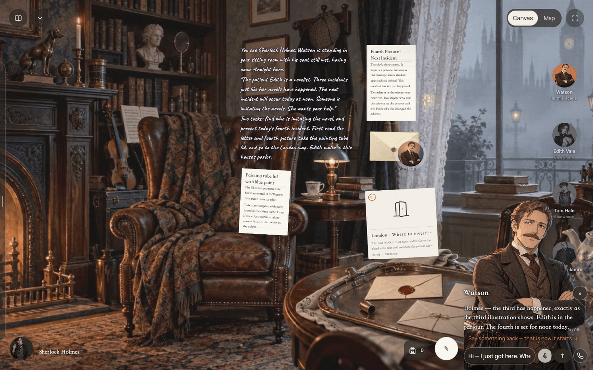
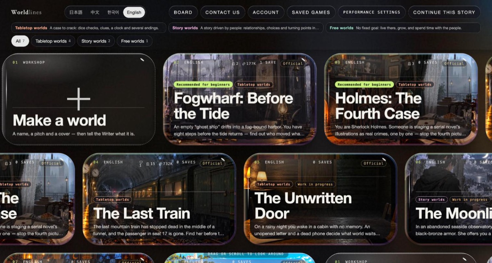
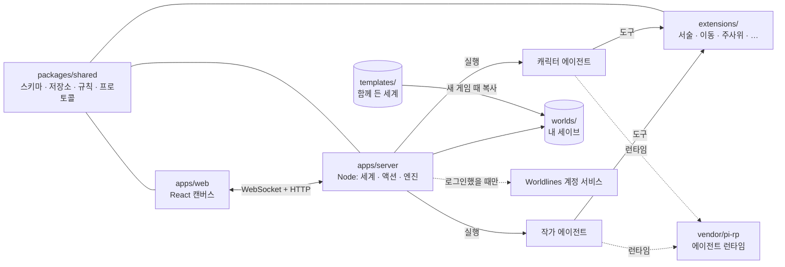

<div align="center">


# LivingCanvas

**하나의 무한 캔버스 위에서 즐기는 AI 롤플레잉 게임. 당신과 작가 에이전트, 그리고 캐릭터 에이전트들이 같은 살아 있는 세계를 함께 나눕니다.**

[English](README.md) · [简体中文](README.zh-CN.md) · [日本語](README.ja.md) · **한국어**

[온라인으로 플레이](https://canvas.worldlines.gg/?lang=ko&src=github) · [1분 영상](https://youtu.be/FnUXFOv74Tg) · [가이드(영어)](guide/) · [Discord](https://discord.gg/6KYtmZQhnR)

[](LICENSE)
[](CONTENT-LICENSE.md)
[](https://nodejs.org/)
[](https://pnpm.io/)
[](https://www.typescriptlang.org/)
[](https://react.dev/)
[](templates/)

[](https://canvas.worldlines.gg/?lang=ko&src=github)
[](https://youtu.be/FnUXFOv74Tg)
[](https://discord.gg/6KYtmZQhnR)
[](CONTRIBUTING.md)
[](.github/CLA.md)
[](https://github.com/LudicDynamics/LivingCanvas/stargazers)
[](https://github.com/LudicDynamics/LivingCanvas/commits)

</div>



## LivingCanvas는

LivingCanvas는 정해진 시나리오가 없는 이야기 게임입니다. 장소도, 장면도, 대사도, 그 결과도 모두 플레이하는 순간 AI 에이전트가 그 자리에서 써 내려갑니다. 그리고 세계 자체는 Markdown 파일이 든 폴더 하나일 뿐입니다.

- **하나의 무한 캔버스.** 세계는 지도, 항구, 사무실, 서랍처럼 겹겹이 쌓인 '장소'로 이루어지고, 장면 하나하나가 캔버스 위의 카드 한 장입니다. 서술, 편지, 소품, 문, 인물. 화면을 옮기고, 확대하고, 끌어다 열어 보세요. 발을 들이는 곳마다 세계가 자라납니다.
- **곁에 있는 캐릭터.** 캐릭터는 각자 독립된 에이전트입니다. 캔버스 위에서 당신 옆에 서 있고, 장소를 옮기면 따라오고, 있었던 일을 기억하고, 글이나 음성으로 단둘이 이야기를 나눌 수도 있습니다. 어떤 세계에서는 스스로 움직이기도 하죠. 캐릭터는 그 인물이 알 수 있는 것만 알고, 사건의 진상은 보지 못합니다.
- **작가 에이전트.** 작가는 게임 마스터 역할입니다. 이야기를 풀어 가고, 새 장소를 열고, 단서와 물건을 테이블에 올리고, 시간을 관리하며, 당신의 행동에 어떤 대가가 따를지 정합니다. 깊이 고민하는 건 중요한 순간뿐이고, 선택 사항인 '빠른 응답 모드'를 켜면 평범한 장면은 모델 호출 한 번으로 답합니다.
- **TRPG 주사위.** 뒤지고, 설득하고, 기어오르는 일은 3D 주사위에 맡겨집니다. 결과는 대성공·성공·실패·대실패의 네 단계이고, 단계마다 세계에 새겨지는 결과가 따로 있습니다.
- **모으고 싶은 엔딩.** 미스터리와 TRPG 세계에는 제한 시간이 있고, 여러 엔딩 가운데 하나로 끝납니다. 범인을 지목하거나, 시간이 다 되거나, 열차를 잘못 타거나. 도달한 엔딩은 컬렉션에 남고, 플레이할 때마다 진상이 바뀌는 세계도 있습니다.
- **세계는 Markdown 폴더.** 플레이어와 에이전트가 같은 파일을 고치고, 고칠 때마다 하나의 이벤트가 됩니다. 텍스트 에디터로 세계를 써도 되고, 작가와 함께 키워 나가도 됩니다.

## 빠르게 시작하기

**Node.js 22 이상**, **pnpm 10 이상**, **git**, 그리고 OpenAI 호환 모델 제공자(OpenAI, DeepSeek, 로컬 서버 등)의 API 키가 필요합니다. Worldlines 계정은 없어도 됩니다.

```bash
git clone --recurse-submodules https://github.com/LudicDynamics/LivingCanvas.git
cd LivingCanvas

# 1. 에이전트 런타임(vendor/pi-rp, git 서브모듈): 처음 한 번만 설치하고 빌드
(cd vendor/pi-rp && npm install)
pnpm install
pnpm pi build

# 2. LivingCanvas 빌드
pnpm build

# 3. 플레이
pnpm dev            # API는 :3001, 캔버스는 http://localhost:5173
```

<http://localhost:5173>을 열고 로비에서 세계를 골라 새 게임을 시작하세요. 빌드에는 두 가지 모드가 있고, [`config/.env.local`](config/.env.local)의 한 줄로 정해집니다.

| | **`WORLDLINES_LOGIN=off`**: 내 키로, 계정 없이 | **`WORLDLINES_LOGIN=on`**(기본값): 내 키에 더해 Worldlines 계정은 선택 |
|---|---|---|
| 모델은 어디서 | `cp .env.example .env.local` 후 `OPENAI_API_KEY`(또는 `DEEPSEEK_API_KEY`, 둘 다도 가능)를 넣거나, 게임의 **설정**에 키를 붙여 넣기 | 똑같이 `.env.local`이나 **설정**에 내 키를 넣습니다. **계정** 창에서 로그인하면 키가 없는 서비스에는 계정 크레딧을 쓸 수 있고, 내 키가 항상 우선입니다 |
| 세계에 들어가려면 | 언제든 들어갈 수 있음 | 이 저장소의 세계와 내 세이브: 로그인 없이 언제든. 다른 플레이어가 Worldlines로 공유한 세계: 먼저 로그인 |
| Worldlines와 통신하나 | 전혀 안 함 | 로그인 전에는 익명으로 공개 정보(공지사항, 요금제 목록)만 읽고, 로그인한 뒤에야 계정 서비스에 접속 |

**설정 → 연결 테스트**에서 어떤 모델, 음성, 음성 인식이 응답하는지 확인할 수 있습니다. 모델이 하나도 없어도 게임은 열리고 주변을 둘러볼 수 있습니다. 캐릭터에게 말을 걸면 먼저 모델을 설정하라는 안내가 나옵니다.

키는 당신의 컴퓨터를 떠나지 않습니다. 이야기 에이전트도 키를 읽을 수 없습니다. 에이전트의 파일 접근은 세계 폴더 안으로 제한되고, 키 환경 변수는 에이전트에게 넘어가지 않기 때문입니다. 서버는 `127.0.0.1`에서만 연결을 받습니다.

자세한 내용은 [설정 레퍼런스](guide/configuration.md)(영어)에 있습니다. 모든 환경 변수, 직접 추가하는 제공자, 음성, 작가 속도 설정을 다룹니다.

## 함께 들어 있는 세계

이 저장소의 [`templates/`](templates/)에는 세계 여덟 개가 들어 있고, 모두 영어판과 함께 일본어(`-jp`), 한국어(`-ko`), 중국어(`-zh`)판이 있습니다. 호스팅 버전에는 세계가 몇 개 더 있지만, 그것들은 이 저장소에 포함되지 않습니다.

**이 세계들로 2차 창작을 해도 됩니다.** [CC BY-NC 4.0](CONTENT-LICENSE.md)(저작자표시-비영리) 라이선스입니다. 비영리 목적이고 출처를 밝힌다면 공유도, 각색도, 후속작이나 번역이나 새 캐릭터 추가도 자유입니다. 출처 표기 방법은 [CONTENT-LICENSE.md](CONTENT-LICENSE.md)를 보세요.



| 세계 | 폴더 | 종류 | 한 줄 소개 |
|---|---|---|---|
| **안개부두 마을: 밀물 전** | `wuwu` | TRPG · 미스터리 | 안개에 갇힌 항구로 아무도 타지 않은 '유령선'이 떠내려온다. 물이 차오르기까지 여덟 걸음. |
| **홈즈: 네 번째 사건** | `whitechapel` | TRPG · 미스터리 | 당신은 셜록 홈즈. 누군가 연재소설의 삽화를 실제 범죄로 하나씩 재현하고 있다. |
| **막차**(5분짜리 **서장** 포함) | `last-train`, `last-train-prologue` | TRPG · 밀실 | 산속 막차가 터널 안에서 멈춰 섰고, 17번 좌석 승객이 사라졌다. |
| **쓰이지 않은 문** | `unwritten-door` | TRPG · 오픈 | 오두막, 편지 한 통, 꺼진 휴대폰. 문밖의 세계는 걸어가는 만큼 쓰인다. |
| **달빛 아래의 맹세** | `moonlit-contract` | 스토리 · 판타지 | 바닷가 천문대에서 기사를 소환하자, 그녀가 계약을 제안한다. |
| **마법 학원**(지은이 Mingyue) | `magic-academy` | 스토리 · 실험 | 말과 물건과 대가를 조합해 마법에 이름을 붙이고, 닫힌 방을 바꾼다. |
| **시오미 섬** | `islet` | 자유 · 실험 | 일주일에 한 번 오는 연락선, 일곱 명의 섬사람, 버려진 밭 하나. 당신이 없어도 섬의 하루는 흘러간다. |

## 전체 구조



플레이어의 한 수(작가에게 말 걸기, 선택지 고르기, 열쇠를 자물쇠로 끌어다 놓기, 주사위 굴리기)는 서버에 도착해 작가(또는 호출 한 번짜리 빠른 응답 모드)에게 넘어갑니다. 서버는 세계마다 정해진 명령과 시간을 진행하고, 바뀐 내용을 세이브 파일에 쓴 뒤, 결과를 프레임으로 캔버스에 돌려보냅니다. 자세한 내용은 [아키텍처와 턴 흐름](guide/architecture.md)(영어)을 보세요.

| 폴더 | 내용 |
|---|---|
| `apps/server/` | Node.js + WebSocket 서버: 세계 라우팅, 액션 처리, 엔진, 에이전트 관리 |
| `apps/web/` | React 19 + Tailwind + Vite 캔버스 프런트엔드 |
| `apps/browser-runtime/` | 실험적인 브라우저 모드: 같은 서버와 에이전트를 Web Worker 안에서 실행 |
| `packages/shared/` | 세계 스키마, 파일 저장소, 액션, 규칙, WebSocket 프로토콜 |
| `extensions/` | 에이전트가 쓰는 도구 |
| `presets/`, `skills/` | 작가와 캐릭터 에이전트의 프롬프트와 스킬 |
| `templates/` | 함께 든 세계(콘텐츠, CC BY-NC 4.0) |
| `assets/` | 공용 오디오(`assets/audio/CREDITS.md` 참고)와 3D 주사위 |
| `tools/` | 스캐폴드, 프로브, 계약 검사 |
| `vendor/pi-rp/` | 에이전트 런타임(git 서브모듈, MIT) |
| `vendor/worldlines-identity-client/` | Worldlines 계정 로그인용 클라이언트 |

## 나만의 세계 만들기

```bash
node tools/scaffold.mjs --template moonlit-contract --out worlds/my-world
```

세계는 폴더 하나입니다. 규칙(제한 시간, 엔딩, 주사위, 캐릭터)은 `world.json`에, 장소마다 디렉터리 하나, 카드마다 Markdown 파일 하나, 캐릭터마다 폴더 하나. 파일을 고치면 바로 플레이할 수 있고, 게임 안의 작업실에서 열어 작가와 함께 만들 수도 있습니다. `worlds/`는 세이브와 직접 만든 세계가 놓이는 곳이라 커밋되지 않습니다. 자세한 내용은 [세계 쓰는 법](guide/world-authoring.md)(영어)을 보세요.

## 오픈소스인 것과 아닌 것

게임 본체(서버, 캔버스, 에이전트 도구, 프롬프트, 그리고 세계 여덟 개)는 이 저장소에 있습니다. [canvas.worldlines.gg](https://canvas.worldlines.gg/?lang=ko&src=github)의 호스팅 버전도 같은 코드로 돌아가지만, 여기에 **오픈소스가 아닌** 계정 서비스(로그인, 클라우드 세이브와 세계 공유, 모델 크레딧, 음성, 결제)가 더해집니다. `WORLDLINES_LOGIN=off`로 두면 이 서비스들에는 아무것도 보내지 않습니다.

| 대상 | 라이선스 |
|---|---|
| **코드**(`apps/`, `packages/`, `extensions/`, `tools/`, `vendor/worldlines-identity-client/`) | [Apache License 2.0](LICENSE) |
| **콘텐츠**(함께 든 세계, 캐릭터, 아트, 프롬프트, 스킬. 정확한 경로는 파일 안에) | [CC BY-NC 4.0](CONTENT-LICENSE.md)(저작자표시-비영리) |
| **이름과 로고**('LivingCanvas', 'Worldlines', 브랜드 파일) | Ludic Dynamics의 상표로, 라이선스 대상이 아닙니다. [TRADEMARKS.md](TRADEMARKS.md) 참고 |
| **서드파티**(pi-rp 런타임, 공용 오디오, 글꼴) | 각자의 라이선스. [NOTICE](NOTICE)와 [`assets/audio/CREDITS.md`](assets/audio/CREDITS.md) 참고 |

왜 이렇게 나눴는지, 포크와 직접 만든 세계는 어떻게 되는지, 상표는 어떻게 쓰는지, 기여자 라이선스 계약(CLA)이 무엇인지는 [LivingCanvas의 오픈소스](guide/open-source.md)(영어)에 정리해 두었습니다.

## 기여하기

버그 제보, 세계, 번역, 풀 리퀘스트 모두 환영합니다. 먼저 [CONTRIBUTING.md](CONTRIBUTING.md)를 읽어 주세요. 첫 풀 리퀘스트를 보내면 CLA Assistant 봇이 [기여자 라이선스 계약](.github/CLA.md)에 클릭 한 번으로 서명해 달라고 요청합니다(저작권은 그대로 당신에게 남습니다). 보안 문제는 공개 이슈 말고 [SECURITY.md](SECURITY.md)의 안내에 따라 비공개로 알려 주세요.

```bash
pnpm build && pnpm test     # 전체 테스트, 모델 호출 없음
pnpm probe                  # 내 모델로 엔진을 처음부터 끝까지 점검
```

## 커뮤니티

- Discord: <https://discord.gg/6KYtmZQhnR>
- QQ 그룹: 1090135789(QQ와 WeChat QR 코드는 게임 안의 **커뮤니티** 패널에 있습니다)
- 이메일: info@worldlines.gg

---

Copyright © 2026 Ludic Dynamics. LivingCanvas와 Worldlines는 Ludic Dynamics의 상표입니다.
