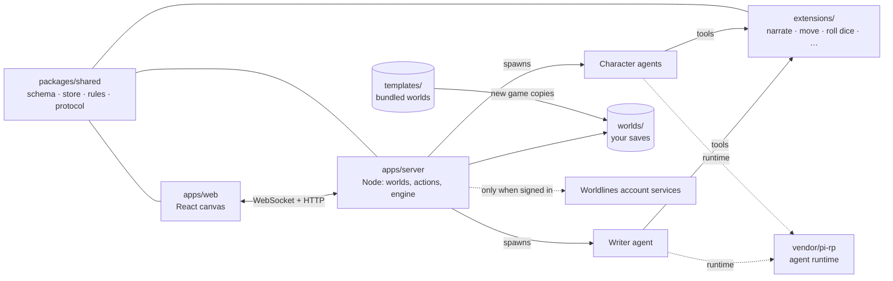

<div align="center">

# LivingCanvas

**An AI roleplay game played on one infinite canvas — where you, a writer agent and a cast of character agents share the same living world.**

[Play the hosted version](https://canvas.worldlines.gg/?lang=en&src=github) · [1-minute film](https://youtu.be/FnUXFOv74Tg) · [Guides](guide/) · [中文说明](README.zh-CN.md) · [Discord](https://discord.gg/6KYtmZQhnR)

[](LICENSE)
[](CONTENT-LICENSE.md)


</div>


## What it is

LivingCanvas is a story game in which nothing is scripted. Every place, scene, reply and consequence is written at play time by AI agents, against a world that is just a folder of Markdown files.

- **One infinite canvas.** A world is a stack of places — map, harbour, office, drawer — and every scene is a card on the canvas: narration, letters, props, doors, people. You pan, zoom, drag and open things; the world grows as you walk into it.
- **Companion characters.** Characters are their own agents. They stand on the canvas next to you, follow you between places, remember what happened, talk to you in private (by text or by voice), and in some worlds take turns of their own. They only see what their character could know — never the secret truth of the case.
- **A writer agent.** The writer plays game master: it narrates, opens new places, puts clues and items on the table, keeps the clock and decides what your actions cost. It thinks hard only on big moments, and an optional fast path answers ordinary beats with a single model call.
- **Tabletop dice.** Searching, persuading or climbing goes to a physical 3D die and four outcome tiers — critical success, success, failure, critical failure — each with its own consequence written into the world.
- **Endings worth collecting.** Mystery and tabletop worlds run on a clock and close on one of several endings: name the culprit, run out of time, take the wrong train. Every ending you reach is kept in your collection, and some worlds change the truth every run.
- **A world is a folder of Markdown.** Players and agents edit the same files and every change is an event, so you can write a world in a text editor — or let the writer grow one with you.

## Quick start

You need **Node.js 22 or newer**, **pnpm 10 or newer**, **git**, and an API key for an OpenAI-compatible model provider (OpenAI, DeepSeek, a local server, …). A Worldlines account is optional.

```bash
git clone --recurse-submodules https://github.com/LudicDynamics/LivingCanvas.git
cd LivingCanvas

# 1. The agent runtime (vendor/pi-rp, a git submodule): install and build once.
(cd vendor/pi-rp && npm install)
pnpm install
pnpm pi build

# 2. LivingCanvas itself.
pnpm build

# 3. Play.
pnpm dev            # API on :3001, the canvas on http://localhost:5173
```

Open <http://localhost:5173>, pick a world in the lobby and start a new game. The build ships in one of two modes, set by one line in [`config/.env.local`](config/.env.local):

| | **`WORLDLINES_LOGIN=off`** — bring your own key, no account | **`WORLDLINES_LOGIN=on`** (as shipped) — your own key, plus an optional Worldlines account |
|---|---|---|
| How you get a model | `cp .env.example .env.local` and set `OPENAI_API_KEY` (and/or `DEEPSEEK_API_KEY`), or paste a key in **Settings** | The same: your own key, set in `.env.local` or **Settings**. Signing in from the **Account** dialog adds account credits for anything you have no key for; your own key always wins |
| Entering a world | Always open | The worlds in this repository and your own saves: always open, no sign-in. Worlds other players share through Worldlines: sign in first |
| What talks to Worldlines | Nothing | Signed out, only anonymous public reads (announcements, the plan list); the account services once you sign in |

**Settings → Connection test** shows which models, voices and speech services answer. Without any model, the game still opens and you can look around; talk to a character and it tells you to set up a model first.

Keys stay on your machine. The story agents cannot read them: their file access is fenced to the world folder and key variables are withheld from their environment. The server listens on `127.0.0.1` only.

More: [Configuration reference](guide/configuration.md) — every variable, custom providers, voices, the writer's speed switches.

## Bundled worlds

This repository carries eight worlds, in [`templates/`](templates/), each in English plus Japanese (`-jp`), Korean (`-ko`) and Chinese (`-zh`) editions. The hosted version has a few more; those are not part of this repository.

**You may remix these worlds.** They are licensed under [CC BY-NC 4.0](CONTENT-LICENSE.md): share them, adapt them, write sequels, translations and new characters, for non-commercial purposes, with credit — see [CONTENT-LICENSE.md](CONTENT-LICENSE.md) for the credit line.


| World | Folder | Kind | In one line |
|---|---|---|---|
| **Fogwharf: Before the Tide** | `wuwu` | Tabletop · mystery | An empty ghost ship drifts into a fog-bound harbour. Eight steps before the tide returns. |
| **Holmes: The Fourth Case** | `whitechapel` | Tabletop · mystery | You are Sherlock Holmes. Someone is staging a serial novel's illustrations as real crimes. |
| **The Last Train** (+ a 5-minute **Prologue**) | `last-train`, `last-train-prologue` | Tabletop · locked room | The last mountain train stops in a tunnel and the passenger in seat 17 is gone. |
| **The Unwritten Door** | `unwritten-door` | Tabletop · open | A cabin, a letter, a dead phone — and a world beyond the door written as you go. |
| **The Moonlit Pact** | `moonlit-contract` | Story · fantasy | In a seaside observatory you summon a knight who offers you a pact. |
| **Magic Academy** (by Mingyue) | `magic-academy` | Story · experimental | Combine a word, an object and a price, name your spell, and change a sealed room. |
| **Shiomi Isle** | `islet` | Free play · experimental | One ferry a week, seven islanders and an abandoned field; island life goes on without you. |

## How it fits together



A player beat — typing to the writer, a choice, dragging a key onto a lock, a roll — reaches the server, which hands it to the writer (or the one-call fast path), runs the world's own commands and clock, writes the changes to the save's files, and streams the result back to the canvas as frames.

- [Architecture and the turn loop](guide/architecture.md)

```text
apps/server/          Node.js + WebSocket server: world routes, action service, engine, agent lifecycle
apps/web/             React 19 + Tailwind + Vite canvas front end
apps/browser-runtime/ experimental browser mode: the same server and agents inside a Web Worker
packages/shared/      world schema, file store, actions, rules and the WebSocket protocol
extensions/           the agents' tools
presets/ skills/      prompts and skills for the writer and character agents
templates/            the bundled worlds (content, CC BY-NC 4.0)
assets/               platform audio (see assets/audio/CREDITS.md) and the 3D die
tools/                scaffold, probes and contract checks
vendor/pi-rp/         agent runtime (git submodule, MIT)
vendor/worldlines-identity-client/  client for signing in to a Worldlines account
```

## Make your own world

```bash
node tools/scaffold.mjs --template moonlit-contract --out worlds/my-world
```

A world is a folder: `world.json` for the rules (clock, endings, dice, characters), a directory per place, a Markdown file per card, a folder per character. Edit the files and play — or open the world in the in-game workshop and let the writer build it with you. `worlds/` is where your saves and your own worlds live; it is never committed.

- [Writing a world](guide/world-authoring.md) — places and cards, search points and the four dice tiers, endings, the clock, loops, characters, editions.

## Open source, and what is not

The game — server, canvas, agent tools, prompts, and eight of its worlds — is in this repository. The hosted service at [canvas.worldlines.gg](https://canvas.worldlines.gg/?lang=en&src=github) runs this same code, plus account services (sign-in, cloud saves and world sharing, model credits, voices, billing) that are **not** open source. With `WORLDLINES_LOGIN=off`, nothing is ever sent to them.

| What | License |
|---|---|
| **Code** (`apps/`, `packages/`, `extensions/`, `tools/`, `vendor/worldlines-identity-client/`) | [Apache License 2.0](LICENSE) |
| **Content** (bundled worlds, characters, art, prompts and skills — exact paths in the file) | [CC BY-NC 4.0](CONTENT-LICENSE.md) |
| **Names and logos** ("LivingCanvas", "Worldlines", the brand files) | Trademarks of Ludic Dynamics, not licensed — see [TRADEMARKS.md](TRADEMARKS.md) |
| **Third-party** (the pi-rp runtime, platform audio, fonts) | Their own licenses — see [NOTICE](NOTICE) and [`assets/audio/CREDITS.md`](assets/audio/CREDITS.md) |

- [Open source at LivingCanvas](guide/open-source.md) — what is open, what stays hosted and why, how the licenses combine, forks and trademarks, the contributor agreement.

## Contributing

Bug reports, worlds, translations and pull requests are welcome. Start with [CONTRIBUTING.md](CONTRIBUTING.md); your first pull request asks you to sign the [contributor license agreement](.github/CLA.md) with one click. Security problems go to [SECURITY.md](SECURITY.md), not the issue tracker.

```bash
pnpm build && pnpm test     # the whole suite, no model calls
pnpm probe                  # end-to-end engine check against your model
```

## Community

- Discord: <https://discord.gg/6KYtmZQhnR>
- QQ group: 1090135789 (the QR codes for QQ and WeChat are in the in-game **Community** panel)
- Email: info@worldlines.gg

---

Copyright © 2026 Ludic Dynamics. LivingCanvas and Worldlines are trademarks of Ludic Dynamics.
