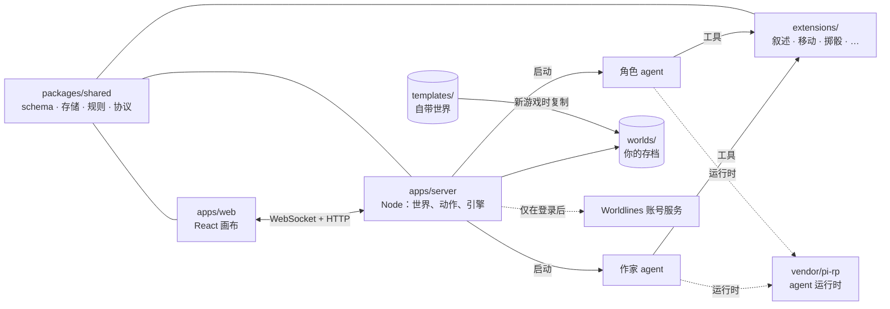

<div align="center">

# LivingCanvas

**在一张无限画布上玩的 AI 角色扮演游戏——你、作家 agent 和一群角色 agent 共享同一个活着的世界。**

[在线游玩](https://canvas.worldlines.gg/?lang=zh-CN&src=github) · [1 分钟短片](https://youtu.be/FnUXFOv74Tg) · [文档（英文）](guide/) · [English](README.md) · [Discord](https://discord.gg/6KYtmZQhnR)

</div>


## 这是什么

LivingCanvas 是一个没有剧本的故事游戏。每个地点、每段场景、每句回答和每个后果，都由 AI agent 在游玩时现场写出；而世界本身只是一个装满 Markdown 文件的文件夹。

- **一张无限画布。** 世界是一层层的地点——地图、码头、办公室、抽屉——每段场景都是画布上的一张卡片：旁白、信件、道具、门、人物。你可以平移、缩放、拖拽、打开东西；走进哪里，世界就长到哪里。
- **陪伴角色。** 每个角色都是独立的 agent：站在你身边、跟着你换地点、记得发生过的事、私下和你说话（打字或语音），在一些世界里还会自己行动。角色只看得到这个人物该知道的东西，看不到案件的真相。
- **作家 agent。** 作家相当于主持人：叙述、开出新地点、把线索和物品摆上桌、管时钟、决定你的行动要付出什么。只在关键时刻深度思考；可选的「快路径」让普通回合只用一次模型调用。
- **跑团骰子。** 搜查、说服、攀爬都交给一颗真实的 3D 骰子，结果分四档——大成功、成功、失败、大失败——每一档都有写进世界里的后果。
- **值得收集的结局。** 推理和跑团世界有时钟，最后落到几个结局之一：指认凶手、时间耗尽、上错了车。达成过的结局会收进你的收藏；有些世界每局的真相都不一样。
- **世界就是一个 Markdown 文件夹。** 玩家和 agent 编辑的是同一批文件，每次改动都是一个事件。你可以用文本编辑器写一个世界，也可以让作家陪你一起把它长出来。

## 快速开始

需要 **Node.js 22+**、**pnpm 10+**、**git**，以及一个 OpenAI 兼容服务商的 API key（OpenAI、DeepSeek、本地模型服务……）。Worldlines 账号可有可无。

```bash
git clone --recurse-submodules https://github.com/LudicDynamics/LivingCanvas.git
cd LivingCanvas

# 1. agent 运行时（vendor/pi-rp，git 子模块）：安装并构建一次
(cd vendor/pi-rp && npm install)
pnpm install
pnpm pi build

# 2. 构建 LivingCanvas
pnpm build

# 3. 开玩
pnpm dev            # API 在 :3001，画布在 http://localhost:5173
```

打开 <http://localhost:5173>，在大厅里选一个世界开新游戏。这个版本有两种模式，由 [`config/.env.local`](config/.env.local) 里的一行决定：

| | **`WORLDLINES_LOGIN=off`**：自带 key，不用账号 | **`WORLDLINES_LOGIN=on`**（默认）：自带 key，Worldlines 账号可选 |
|---|---|---|
| 模型从哪来 | `cp .env.example .env.local`，填 `OPENAI_API_KEY`（和/或 `DEEPSEEK_API_KEY`），或在游戏的**设置**里粘贴 key | 一样：在 `.env.local` 或**设置**里填自己的 key。在**账号**面板登录后，没填 key 的服务可以用账号额度；自己的 key 永远优先 |
| 进入世界 | 随时可进 | 本仓库自带的世界和你自己的存档：随时可进，不用登录。其他玩家通过 Worldlines 分享的世界：先登录 |
| 会联系 Worldlines 吗 | 不会 | 未登录时只有匿名的公开读取（公告、价目表）；登录后才访问账号服务 |

**设置 → 连接测试**会显示哪些模型、语音和语音识别能用。没有任何模型时，游戏照样能打开、能四处看看；跟角色说话时会提示你先设置模型。

key 只留在你的电脑上。故事 agent 读不到它们：agent 的文件访问被限制在世界文件夹里，key 变量也不会传进 agent 的环境。服务只监听 `127.0.0.1`。

更多：[配置参考](guide/configuration.md)（英文）——所有环境变量、自定义服务商、语音、作家提速开关。

## 自带的世界

本仓库带了八个世界，在 [`templates/`](templates/) 下，每个都有英文版和日文（`-jp`）、韩文（`-ko`）、中文（`-zh`）版。托管版上还有另外几个世界，不在本仓库里。

**这些世界可以二创。** 它们按 [CC BY-NC 4.0](CONTENT-LICENSE.md)（署名—非商业）授权：可以分享、改编、写续作、翻译、加新角色，只要是非商业用途并署名；署名写法见 [CONTENT-LICENSE.md](CONTENT-LICENSE.md)。


| 世界 | 目录 | 类型 | 一句话 |
|---|---|---|---|
| **雾坞镇·潮前** | `wuwu` | 跑团 · 推理 | 一艘空无一人的「幽灵船」漂进雾锁的港口，潮水回来之前你只有八步。 |
| **福尔摩斯：第四件案子** | `whitechapel` | 跑团 · 推理 | 你就是福尔摩斯。有人把连载小说的插图一幅幅做成真实的罪案。 |
| **末班车**（含 5 分钟**序章**） | `last-train`、`last-train-prologue` | 跑团 · 密室 | 山里的末班车停在隧道正中，17 号座的乘客不见了。 |
| **未写之门** | `unwritten-door` | 跑团 · 开放 | 小屋、一封信、一部没电的手机——门外的世界边走边写。 |
| **月下之誓** | `moonlit-contract` | 剧情 · 奇幻 | 在海边废弃的天文台召唤出一位骑士，她向你提出契约。 |
| **魔法学院**（作者 Mingyue） | `magic-academy` | 剧情 · 实验 | 把一个词、一件东西和一个代价组合起来，给你的小魔法命名，改变一间封闭的房间。 |
| **潮见岛** | `islet` | 自由 · 实验 | 一周一班渡轮、七个岛民、一块荒废的田；你不在时，岛上的日子照样过。 |

## 整体结构



玩家的一拍——对作家说一句话、选一个选项、把钥匙拖到锁上、掷一次骰子——到达服务端后，交给作家（或一次调用的快路径），再执行世界自己的命令和时钟，把改动写进存档文件，最后以帧的形式推回画布。详见 [架构与回合流程](guide/architecture.md)（英文）。

| 目录 | 内容 |
|---|---|
| `apps/server/` | Node.js + WebSocket 服务：世界路由、动作服务、引擎、agent 生命周期 |
| `apps/web/` | React 19 + Tailwind + Vite 画布前端 |
| `apps/browser-runtime/` | 实验性的浏览器模式：同一套服务端和 agent 跑在 Web Worker 里 |
| `packages/shared/` | 世界 schema、文件存储、动作、规则和 WebSocket 协议 |
| `extensions/` | agent 的工具 |
| `presets/`、`skills/` | 作家和角色 agent 的提示词与技能 |
| `templates/` | 自带世界（内容，CC BY-NC 4.0） |
| `assets/` | 平台音频（见 `assets/audio/CREDITS.md`）和 3D 骰子 |
| `tools/` | 脚手架、探针和契约检查 |
| `vendor/pi-rp/` | agent 运行时（git 子模块，MIT） |
| `vendor/worldlines-identity-client/` | 登录 Worldlines 账号用的客户端 |

## 做你自己的世界

```bash
node tools/scaffold.mjs --template moonlit-contract --out worlds/my-world
```

一个世界就是一个文件夹：`world.json` 写规则（时钟、结局、骰子、角色），每个地点一个目录，每张卡片一个 Markdown 文件，每个角色一个文件夹。改文件、开玩；或者在游戏里的工坊打开它，让作家陪你一起写。`worlds/` 是你的存档和自制世界所在的地方，永远不会被提交。详见 [写世界指南](guide/world-authoring.md)（英文）。

## 开源与不开源的部分

游戏本身——服务端、画布、agent 工具、提示词，以及其中八个世界——都在这个仓库里。[canvas.worldlines.gg](https://canvas.worldlines.gg/?lang=zh-CN&src=github) 上的托管版跑的是同一份代码，另外加上**不开源**的账号服务（登录、云存档和世界分享、模型额度、语音、计费）。设成 `WORLDLINES_LOGIN=off` 时，不会向这些服务发送任何东西。

| 部分 | 许可 |
|---|---|
| **代码**（`apps/`、`packages/`、`extensions/`、`tools/`、`vendor/worldlines-identity-client/`） | [Apache License 2.0](LICENSE) |
| **内容**（自带世界、角色、美术、提示词和技能，具体路径见文件） | [CC BY-NC 4.0](CONTENT-LICENSE.md)（署名—非商业） |
| **名称和标志**（「LivingCanvas」「Worldlines」及品牌文件） | Ludic Dynamics 的商标，不在授权范围内，见 [TRADEMARKS.md](TRADEMARKS.md) |
| **第三方**（pi-rp 运行时、平台音频、字体） | 各自的许可，见 [NOTICE](NOTICE) 和 [`assets/audio/CREDITS.md`](assets/audio/CREDITS.md) |

为什么这样分、fork 和自制世界怎么算、商标怎么用、贡献协议（CLA）是什么：见 [开源说明](guide/open-source.md)（英文）。

## 参与贡献

欢迎提 bug、贡献世界、翻译和 PR。先看 [CONTRIBUTING.md](CONTRIBUTING.md)；第一次提 PR 时，CLA Assistant 机器人会请你一键签署[贡献者许可协议](.github/CLA.md)（你保留版权）。安全问题请按 [SECURITY.md](SECURITY.md) 私下报告，不要开公开 issue。

```bash
pnpm build && pnpm test     # 全部测试，不调用模型
pnpm probe                  # 用你的模型跑一遍端到端引擎检查
```

## 社群

- Discord：<https://discord.gg/6KYtmZQhnR>
- QQ 群：1090135789（QQ 和微信的二维码在游戏里的**社群**面板）
- 邮箱：info@worldlines.gg

---

Copyright © 2026 Ludic Dynamics。LivingCanvas 和 Worldlines 是 Ludic Dynamics 的商标。
