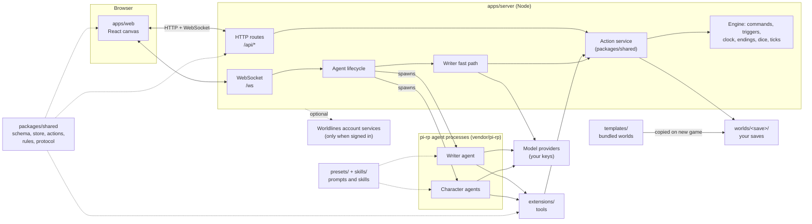
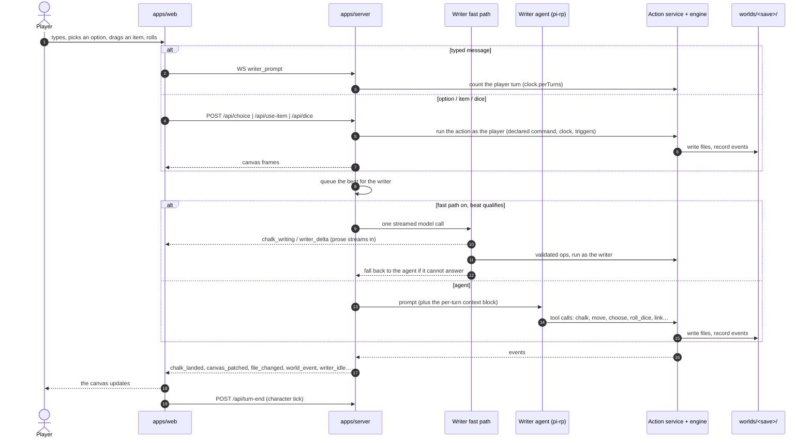

# Architecture and the turn loop

This page explains how LivingCanvas is put together: which process does what, what happens between the moment a player acts and the moment the canvas changes, how the agents are kept inside their world, and where state is stored. It describes the code as it is in this repository.

- [The pieces](#the-pieces)
- [A world on disk](#a-world-on-disk)
- [The turn loop](#the-turn-loop)
- [The writer agent](#the-writer-agent)
- [The writer fast path](#the-writer-fast-path)
- [Engine rules: commands, triggers, clock, endings](#engine-rules-commands-triggers-clock-endings)
- [Character agents](#character-agents)
- [What reaches the canvas](#what-reaches-the-canvas)
- [Security model](#security-model)
- [Where state lives](#where-state-lives)
- [Repository layout](#repository-layout)

## The pieces

| Piece | What it does |
|---|---|
| [`apps/web`](../apps/web/) | The React 19 + Vite canvas. One WebSocket ([`useWorld`](../apps/web/src/state/useWorld.ts)) carries every live frame; ordinary reads and player actions are HTTP calls to `/api/*`. In development Vite serves the page on port 5173 and proxies `/api` and `/ws` to the server on 3001. |
| [`apps/server`](../apps/server/) | Node + Express + `ws`. It holds one active world at a time, serves the world routes ([`routes/world.ts`](../apps/server/src/routes/world.ts)), owns the agent processes ([`engine/lifecycle.ts`](../apps/server/src/engine/lifecycle.ts)) and turns everything that happens into WebSocket frames ([`engine/event-bridge.ts`](../apps/server/src/engine/event-bridge.ts)). |
| [`packages/shared`](../packages/shared/) | Code used by the server, the web app and the agents' tools alike: the world schema (Zod), the file + SQLite store, the action service (`createActionService(store, actor)`), the rules, the renderers that build the writer's context, and the WebSocket vocabulary ([`protocol/ws.ts`](../packages/shared/src/protocol/ws.ts)). |
| [`vendor/pi-rp`](../vendor/pi-rp/) | The agent runtime (a git submodule). The server starts one pi-rp process for the writer and one per character the player talks to, and drives them over RPC. |
| [`extensions/`](../extensions/) | The agents' tools. Every tool is a thin shell over the same action service the player's UI uses, so an agent and a player doing the same thing produce the same files and the same events. |
| [`presets/`](../presets/) and [`skills/`](../skills/) | The writer, character and initializer prompts, and the platform skills (how to narrate with cards, run dice, use world commands, cast voices…). A world adds its own skills in `<world>/skills/`. |
| [`templates/`](../templates/) | The bundled worlds. Starting a new game copies a template into `worlds/`; a template is never played in place. |
| [`apps/browser-runtime`](../apps/browser-runtime/) | Experimental: the same server and pi-rp CLI, bundled to run inside a Web Worker in the player's tab. See its [README](../apps/browser-runtime/README.md). |
| Worldlines account services | Optional. With `WORLDLINES_LOGIN=on` and a signed-in account, models, voices, cloud saves and world sharing can be paid for by that account. Your own keys always win. See the [configuration reference](configuration.md). |

## A world on disk

A world is a folder. The files are the truth: there is no second copy of the story state somewhere else.

| Path | Holds |
|---|---|
| `world.json` | The manifest: title, language, entry place, rules (dice system, clock, tick, models…). |
| `world/` | The places. Every directory under `world/` is a layer (map → harbour → office → drawer); every Markdown file in it is a card. Interactive fields (`choice`, `roll_dice`, `status`…) are card frontmatter. |
| `characters/<id>/` | A character's own corner (its "nook"): profile, notes, an optional `preset.json`. |
| `player/` | The player's bag and notes. |
| `command/` | Declared engine moves (`*.yaml`) that options, triggers and character ticks run. |
| `endings/` | The endings a run can reach. |
| `skills/` | The world's own skills (voice, style, rules) for its agents. |
| `.airpworld/` | Runtime state of this save. See [Where state lives](#where-state-lives). |

Layout, presence, history, events and cursors live in SQLite databases under `.airpworld/`. Every write to the world goes through the action service and records an event; watching the file system only triggers re-reads. [Writing a world](world-authoring.md) covers the format in detail.

## The turn loop

A *beat* is one thing the player does that the world should answer. The player can:

| The player… | Reaches the server as | Counts as a player turn (`clock.perTurns`) |
|---|---|---|
| types to the writer | WS `writer_prompt` | yes (`request`) |
| presses an option on a card | `POST /api/choice` | yes, by the action itself |
| drags an item onto something | `POST /api/use-item` | yes, by the action itself |
| rolls a die / a skill check | `POST /api/dice`, `POST /api/skill-check` | yes, by the action itself |
| talks to a character | WS `character_start` / `character_prompt` | yes (`talk`), once per line |
| talks to an NPC card | `POST /api/npc/talk` | yes (`talk`) |
| walks through a door | `POST /api/enter-layer` | no |

A world whose `clock` has `perTurns` advances its clock by these turns. Messages to the writer and lines said to a character are counted by the server ([`engine/player-turn.ts`](../apps/server/src/engine/player-turn.ts)); options, rolls and item uses are counted by the action itself. The writer's own moves are never player turns, so each beat counts exactly once on either writer path.

Step by step:

1. **Input.** A typed message goes over the WebSocket as `writer_prompt` with the current layer. Clicks, drags and rolls go to their HTTP route, which runs the action as the player first: the option's declared command, the item's effect, the roll. Whether a choice then starts a writer turn is a per-save setting (`autoWrite`: `off`, `scenes`, `scenes-and-choices`; the default is `scenes-and-choices`).
2. **Queue.** [`lifecycle.submitWriter`](../apps/server/src/engine/lifecycle.ts) runs beats one at a time. Once the current beat has *landed* (its first chalk or world-file write), one more beat may queue behind it, so the player is not held until the writer fully settles.
3. **Answer.** The beat goes to the [fast path](#the-writer-fast-path) when it is on and the beat qualifies; otherwise to the [writer agent](#the-writer-agent).
4. **Effects.** Every write goes through the action service, which checks paths and rules, writes the files, records events and evaluates the world's triggers.
5. **Frames.** The event bridge turns agent output and world events into WebSocket frames; the canvas renders them.
6. **Character tick.** After each beat the page calls `POST /api/turn-end`, where the [character tick](#character-ticks) may move someone on the page.

## The writer agent

One writer process per world, reused across beats ([`engine/launch.ts`](../apps/server/src/engine/launch.ts)). It runs with the world folder as its working directory, the [`writer`](../presets/writer.json) preset, the tools from [`extensions/tools.ts`](../extensions/tools.ts), the platform skills from [`skills/`](../skills/) and the world's own `skills/`. pi-rp's automatic discovery (global skills, extensions, context files, prompt templates, themes) is switched off, so the agent sees only what LivingCanvas hands it. The writer's conversation is kept in its own session file under `.airpworld/sessions/` and resumed on restart.

Each beat, an extension ([`extensions/context.ts`](../extensions/context.ts)) adds a temporary context block: the state of the current place, the events since the writer last looked, and the next step. The current page's files are included up to a budget, so the writer rarely has to read them itself.

The writer's tools (names as the model sees them):

| Tool | What it does |
|---|---|
| `chalk` | Write narration onto the canvas as a card (streams to the player while it is written) |
| `look_at`, `view_canvas`, `screenshot_canvas` | Read a card or a place; see the canvas as the player does |
| `move`, `delete` | Take, place or remove a card |
| `move_to`, `set_following` | Move a character to a place; make a character follow the player |
| `choose` | Record the player's choice of a declared option (runs its command) |
| `roll_dice`, `search`, `skill_check`, `dice_consequence` | Put a die on the table; search a declared spot; an attempt against a skill; pay out a roll's tier |
| `trigger_keyword` | Fire a declared turning point |
| `use_item_on` | Apply a bag item to something |
| `link`, `arrange`, `arrange_canvas` | Draw a line between cards; tidy the layout |
| `get_component`, `show` | Use and present rich card components |
| `create_char`, `edit_character_config` | Add a character; change a character's settings |
| `generate_image`, `set_music` | Draw missing art; change the music |
| `read_conversation` | Read a character's private chat on demand (writer only) |

Per-beat tuning ([`engine/writer-beat-policy.ts`](../apps/server/src/engine/writer-beat-policy.ts)):

- **Thinking.** Ordinary beats run with reasoning off; *big* beats (words about leaving, endings, time passing, the loop), a beat after a failed tool call, and authoring keep the configured level.
- **Tool budget.** At most 24 tool calls per beat by default; then the writer is told to wrap up.
- **Compaction.** Between beats, once the writer's context passes 64k tokens, older beats are folded into a summary, keeping the most recent 20k tokens verbatim.
- **Hard limits.** A turn is aborted after 90 s without progress (text and tool activity refresh it) and after 5 minutes in total.

Every knob is listed in the [configuration reference](configuration.md#writer-tuning). Walking into a place that has not been written yet is not a writer turn: a separate initializer (the [`scene-init`](../presets/scene-init.json) preset) builds it.

## The writer fast path

[`engine/writer-fast-path.ts`](../apps/server/src/engine/writer-fast-path.ts) answers a play beat with **one** streamed model call instead of the agent's tool loop. The server packs everything the beat needs into the request: the world's rules, every card of the current place, the bag, who is here, the exits and the recent beats ([`packages/shared/src/fast-path/`](../packages/shared/src/fast-path/)). The model replies with one JSON object: the chalk to show, and a short list of engine ops (`choose`, `search`, `skill_check`, `use_item_on`, `take`, `note`, `move_to`, `link`, `trigger_keyword`, `dice_consequence`).

- The chalk streams on the same lane as the agent's (`chalk_writing` → `writer_delta` → `chalk_landed`).
- The ops are validated, then run through the action service **as the writer**, exactly as the agent's tool calls would be. Refused ops get one repair round.
- The beat goes to the agent instead when it does not qualify: an author request, a place that is not written yet, a reference outside the current place and the bag, no model endpoint, the model answering `"route":"agent"`, or two beats in a row in the same place with every op refused.

| Mode (`AIRP_WRITER_FAST_PATH`) | Behaviour |
|---|---|
| `off` | The agent answers every beat. |
| `shadow` | The agent answers; the fast path runs beside it and only logs what it would have done to `.airpworld/fast-path.log`. |
| `on` (default) | Qualifying beats are answered by the fast path; the rest go to the agent. |

A world author can switch it off with `"writer": { "fastPath": false }` in `world.json`; a player can switch it off for one save (`writerFastPath: false` in the save's settings); an author's own creation worlds never use it. The fast path calls an OpenAI-compatible chat endpoint: your own `DEEPSEEK_API_KEY` first, otherwise the Worldlines AI service (the signed-in account, or the guest trial). With neither, every beat goes to the agent.

## Engine rules: commands, triggers, clock, endings

The agents narrate; the engine decides. Everything that changes the outcome of a run is declared by the world and executed by [`packages/shared/src/commands/`](../packages/shared/src/commands/) and [`packages/shared/src/actions/`](../packages/shared/src/actions/):

- **Commands** (`command/*.yaml`) are the world's declared moves: give or consume items, set states, pass time, create or edit cards, take the player somewhere, put a die on the table, reach an ending or reset the loop. Options, triggers, NPC gives and character ticks run them; agents cannot invent new ones mid-play.
- **Triggers** fire commands when their conditions become true (`on` blocks), or by meaning through `trigger_keyword`.
- **Clock.** A world can move its clock by player turns (`clock.perTurns`) as well as by commands.
- **Dice.** Rolls are resolved by the engine in four tiers; a big success or failure the writer leaves unpaid gets the world's default consequence ([`engine/dice-settle.ts`](../apps/server/src/engine/dice-settle.ts)).
- **Endings and loops.** Reaching an ending, or resetting a loop, is an engine result. On a loop reset the files return to the loop start, characters forget, and the writer starts a new thread.

## Character agents

Each character the player talks to gets its own pi-rp process with its own session file (`.airpworld/sessions/char-<id>.jsonl`), so its memory belongs to it and travels with the save. The preset is the character's own `characters/<id>/preset.json` when the world ships one, otherwise [`presets/character.json`](../presets/character.json). Characters use the same tools as the writer, except `read_conversation`.

**A fenced view of the world.** A character is a person in the world, not its author. [`packages/shared/src/rules/character-view.ts`](../packages/shared/src/rules/character-view.ts) decides, per path, whether a character reads a file as is, through a projection, or not at all. Projections remove `intent` notes, NPC briefs, hidden states and dice outcomes; `command/`, `endings/`, run overlays, engine data and other characters' private files are withheld. The read fence applies this to the character's file tools, including subagents it spawns.

**Presence and following.** Where a character stands is a row in the save's database, not a file move. `move_to` puts a character in a place; `set_following` makes them walk with the player, and followers are carried along when the player enters a new layer. The canvas shows who is present on each page.

**Character ticks.** In a world that declares a `tick` block, every few beats one person on the player's page shows an *intent*: a move from a closed menu the author declared, each backed by a command. The player has a beat to answer it (take the thing first, enter first, guard, or talk); otherwise it lands and its command runs. This is rule-based and works without any model. Optionally a cheap model call lets the character pick its move and say a line in its own voice; without a reachable model the rules alone decide, and the player sees no error. The per-save setting `characterTick` (`off`, `easy`, `standard`) tunes it.

**Private chats and the writer.** The writer does not see a character's conversation as it happens. When a chat ends (the dialogue closes, the nook closes, a voice call hangs up, or the character has been quiet for a while), the server summarizes the new turns with a cheap model call and records one `character_talked` event. The writer sees that summary in its next context block and can read the full transcript with `read_conversation`. If something was learned or promised, the writer may take one quiet beat to show it on the canvas (per-save setting `chatBeats`).

**NPC cards** are not agents: a line said to an NPC card becomes one writer turn with that NPC's brief ([`engine/npc-talk.ts`](../apps/server/src/engine/npc-talk.ts)), and the exchange is written onto the card.

## What reaches the canvas

The WebSocket vocabulary is defined in [`packages/shared/src/protocol/ws.ts`](../packages/shared/src/protocol/ws.ts); the client connects to `/ws?v=1`. The main frames the canvas consumes:

| Frame | Meaning |
|---|---|
| `chalk_writing`, `writer_delta`, `chalk_landed` | A chalk card appears, its prose streams in, it lands |
| `card_writing` | A component card is being written (skeleton state) |
| `canvas_patched`, `card_position`, `file_changed` | Cards were added, moved or changed |
| `world_event` | An event from the action service (choice made, item obtained, ending reached…) |
| `dice_result` | A roll resolved |
| `character_delta`, `character_message`, `character_idle` | A character agent is speaking, has spoken, is done |
| `agent_activity`, `agent_progress`, `tool_start`, `tool_end` | What an agent is doing right now |
| `image_generation_progress`, `image_landed` | Scene art being drawn |
| `writer_idle`, `turn_aborted` | The writer settled, or a turn was stopped |
| `replay_done` | On reconnect, the last complete turns were replayed |

Client commands are `writer_prompt`, `writer_abort`, `airp_init`, `abort`, `character_start`, `character_prompt`, `character_abort`, `character_stop` and `character_talk_end`. Every command names the save it is for; a command for another save is refused.

## Security model

- **Local only by default.** The server listens on `127.0.0.1`. Setting `AIRP_HOST=0.0.0.0` exposes it on your network, with no login in front of it. The connection settings, account and sync routes answer only requests from this computer, and WebSocket upgrades from another browser origin are refused unless listed in `AIRP_WS_ALLOWED_ORIGINS`.
- **Agents read only their world.** pi-rp's `read`, `grep`, `find` and `ls` are fenced to the world folder and the shared `skills/` ([`extensions/toolkit/read-fence.ts`](../extensions/toolkit/read-fence.ts)); symlinks are resolved before the check. `bash` is refused for every agent. Character agents additionally get the projected view described above.
- **Keys withheld.** An agent process receives only the environment it needs ([`engine/agent-env.ts`](../apps/server/src/engine/agent-env.ts)): every other variable whose name looks like a credential (voice keys, account settings, tokens) is removed before the process starts. The account session never reaches an agent: when an agent uses account credits, it calls a loopback proxy on the server, which adds the token.
- **Keys never go to the browser.** Settings report whether a key is set, never its value.

## Where state lives

| Location | Holds |
|---|---|
| `worlds/<save>/` | One save: the world files as they are now. Git-ignored. |
| `worlds/<save>/.airpworld/` | Runtime state of that save: `canvas.db` and `history.db` (layout, presence, events, cursors), `sessions/` (writer and character conversations), `snapshots/` (snapshot archives for rollback), `settings.json` (per-save play settings), `model-preferences.json` (the Agents panel's picks), `assets/` (generated art), `tts-cache/`, `fast-path.log`. |
| `.pi/agent/` | The agent runtime's config for this checkout: `models.json` (providers and models), `auth.json`. The server points pi-rp here, never at your home directory. |
| `.env.local` (repository root) | Your keys and model settings. Git-ignored. See the [configuration reference](configuration.md). |
| `~/.config/airp/` | The Worldlines sign-in session, only if you sign in. |

## Repository layout

| Path | Contents |
|---|---|
| [`apps/server/`](../apps/server/) | Node server: world routes, WebSocket, agent lifecycle, fast path, account clients (`src/sync/`) |
| [`apps/web/`](../apps/web/) | React 19 + Tailwind + Vite canvas front end |
| [`apps/browser-runtime/`](../apps/browser-runtime/) | Browser mode: the server and agents in a Web Worker (experimental) |
| [`packages/shared/`](../packages/shared/) | World schema, store, action service, rules, renderers, WebSocket protocol, build mode |
| [`extensions/`](../extensions/) | The agents' tools (loaded by pi-rp as TypeScript, no build step) |
| [`presets/`](../presets/) | Writer, character and initializer presets |
| [`skills/`](../skills/) | Platform skills shared by every world |
| [`templates/`](../templates/) | Bundled worlds and their language editions |
| [`assets/`](../assets/) | Platform audio and the 3D dice model |
| [`tools/`](../tools/) | Scaffolding, probes and contract checks |
| [`config/`](../config/) | The build-mode file (`.env.local`) and the bundled model list |
| [`vendor/pi-rp/`](../vendor/pi-rp/) | Agent runtime (git submodule, MIT) |
| [`vendor/worldlines-identity-client/`](../vendor/worldlines-identity-client/) | Client for signing in to a Worldlines account |
